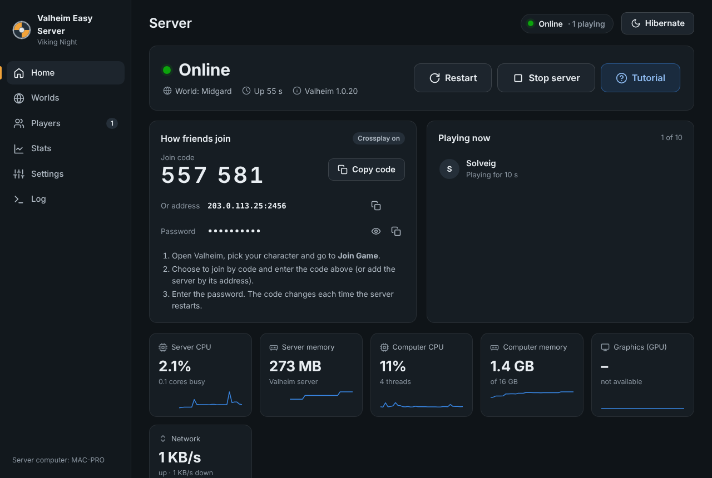
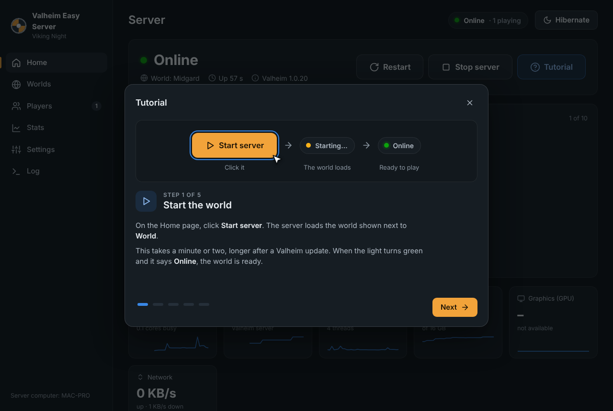
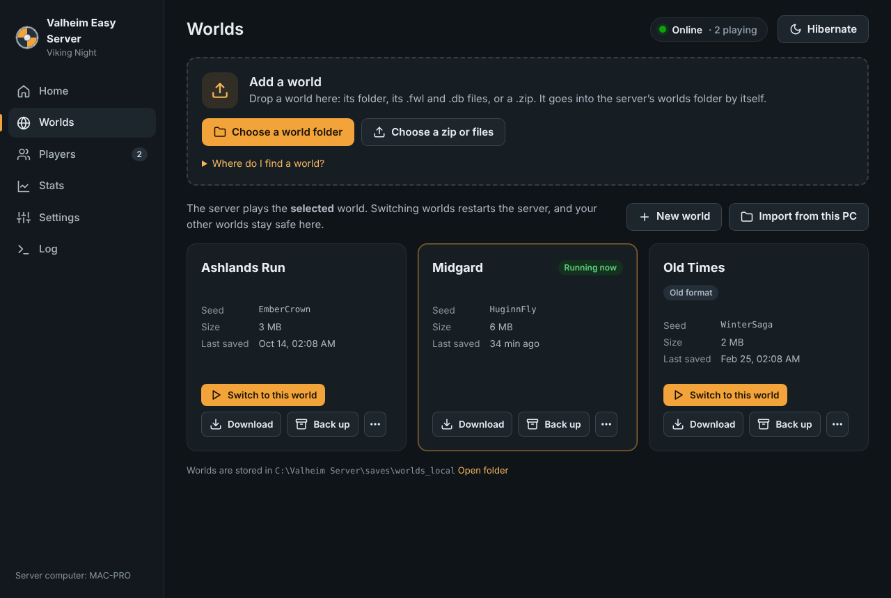
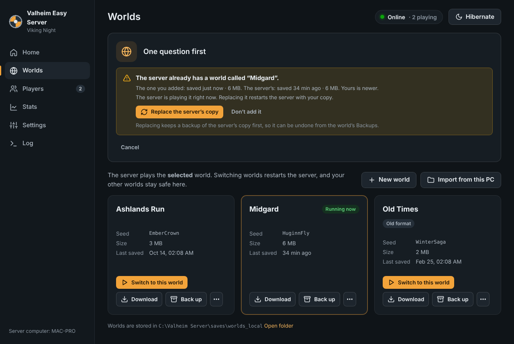
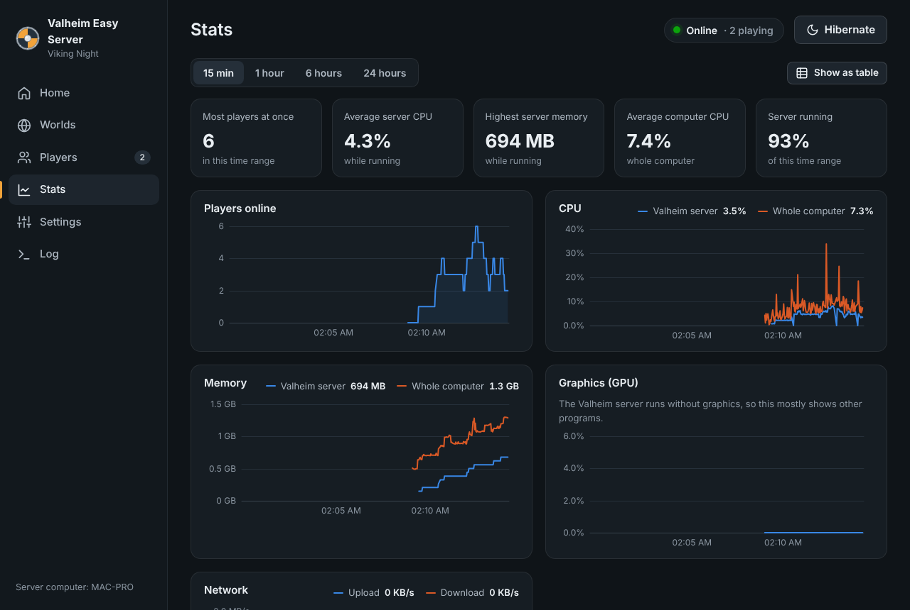
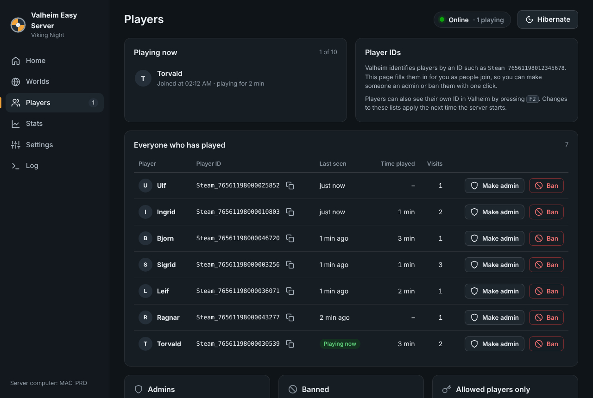

# Valheim Easy Server

Run a Valheim dedicated server on a spare Windows PC, such as an old Mac Pro running Windows 10 through Boot Camp, and look after it with a simple app on that computer. Friends who help run it use the same app through an IP KVM or remote desktop. Nobody needs to touch a command line.



## What it does

- **Start and stop with one button.** Stopping always saves the world first, the same way the official guide does it (Ctrl+C), just without the console window.
- **A tutorial for friends.** The **Tutorial** button, right next to Start server, explains the basics in five short steps with pictures of the real buttons: starting the server, joining from Valheim, stopping, switching worlds and hibernating.
- **How to join, always visible.** The panel shows the crossplay join code, the address and the password, with copy buttons. Crossplay codes work without setting up your router.
- **Several worlds.** Switch worlds with one click, create new ones (with Valheim's difficulty presets and world modifiers, Fire hazard included), rename old ones, and delete worlds. Deleted worlds keep a backup.
- **Add a world by dropping it in.** Drop a world onto the app (a Valheim 1.0 world folder, an older `.fwl` + `.db` pair, or a zip of either) and it goes into the server's worlds folder by itself. The app only asks when the server already has a world with that name: replace it (keeping a backup) or keep both. Replacing the world that's running restarts the server with the new copy. Any world can be downloaded as a zip, and "Import from this PC" copies worlds from the Valheim game installed on the server computer.
- **Mods per world.** Pick from six mods for each world, among them Riverheim's new landscapes, Seasonality and Plant Everything, all kept up to date for Valheim 1.0 and downloaded from Thunderstore. The app downloads them with what they need when that world starts and keeps them up to date; worlds without mods run plain Valheim. A pop-up tells players which mods they need and where to download them.
- **Join code in Discord.** Each time the server is online, it can post the join code in your Discord channel, and say when the server stops.
- **Backups.** Valheim's own automatic backups and the app's backups are listed together, and each one can be restored or downloaded. The app makes a backup before anything is replaced, restored over or deleted.
- **Hibernate or sleep, and wake with Wake-on-LAN.** Saves the world, stops the server and hibernates the computer (or puts it to sleep). Wake it from an IP KVM's Wake-on-LAN, or with the power button, and the server starts again. It can also rest on its own when nobody has played for a while.
- **Stats.** CPU, memory, GPU and network use for the Valheim server and the whole computer, over 15 minutes to 24 hours. A breakdown by number of players estimates what each extra player costs.
- **Players.** See who's online and everyone who has played, with total play time. Make someone an admin or ban them with one click, without hunting for Steam IDs.
- **Looks after itself.** It updates the server through Steam before each start, so friends never get a "version mismatch". It restarts the server after a crash and keeps Windows from falling asleep while people play. Closing the window doesn't stop the server, and the app picks it back up when it starts again.
- **Keeps itself up to date.** Every hour the app checks this project on GitHub for a newer version and installs it once nothing is in progress. The Valheim server keeps running while the app restarts, so nobody is disconnected.
- **Only on this computer.** The control panel only works on the server computer itself, so there's no password to set up and nothing for strangers to reach. Friends use it through an IP KVM or remote desktop, the same way they'd use the computer.

| Tutorial | Worlds | Adding a world | Stats | Players |
|---|---|---|---|---|
|  |  |  |  |  |

## Getting it

1. Open the [newest release](../../releases/latest) and download **ValheimEasyServer-windows.zip**.
2. Unzip it. You get `ValheimEasyServer.exe` and `READ-ME-FIRST.txt`.

You only do this once: after that, the app [updates itself](#app-updates).

## Setting up the server computer (once)

1. Make a folder such as `C:\Valheim Server` and put `ValheimEasyServer.exe` in it. Everything goes in that folder: the server, worlds, backups and logs. To move or back up the whole setup, copy the folder. If other people have their own Windows accounts on this computer, use a folder inside your own user folder instead (such as `C:\Users\you\Valheim Server`): every account can change a folder made directly on `C:\`.
2. Double-click `ValheimEasyServer.exe`. If Windows shows **"Windows protected your PC"**, click **More info → Run anyway**. The app isn't code-signed, so Windows doesn't recognise it yet.
3. The control panel opens in its own window. Click **Install the server**. It downloads the free Valheim dedicated server from Steam with Valve's SteamCMD tool, about 1 GB. You don't need to own Valheim on this PC.
4. Go to **Settings** and set the server name and password. A password is generated for you, and friends need it to join.
5. Already have a world? Drop it on **Add a world** on the Worlds page (see [Worlds](#worlds)). Otherwise the server creates a new one.
6. Click **Start server**. When it says **Online**, friends can join.
7. Work through **Setup on this computer** on the Home page:
   - **Allow it through Windows Firewall.** Windows asks for permission; click Yes. If Windows showed its own firewall pop-up earlier and it was dismissed, this also fixes that.
   - **Turn on hibernation**, which the Hibernate button needs.
   - **Turn on Wake-on-LAN**, so the IP KVM can wake the computer (see [below](#hibernate-sleep-and-waking-up)).
   - **Start this app with Windows**, so everything comes back after a reboot.

The app lives next to the clock as a shield icon. Click the icon to open the panel; right-click it for Start, Stop, Hibernate and Close.

## How friends join the game

The **How friends join** card on the Home page has everything:

- **Crossplay on (recommended, the default).** Friends enter the 6-digit **join code** in Valheim under *Join Game*, then the password. This works for Steam, Xbox, PlayStation 5, Switch 2 and Game Pass players, and needs **no router setup**. The code changes each time the server restarts. Valheim doesn't accept local network addresses for crossplay servers, so people in the same house use the code too.
- **Crossplay off (Steam only).** Friends join by address. Friends outside your home need **UDP ports 2456–2457 forwarded** on your router to the server computer.

Everyone needs the same Valheim version as the server. The app updates the server before each start, so friends just need to update their game.

## Posting the join code in Discord

The join code changes every time the server starts, so the app can post it in a Discord channel for you. In **Settings → Discord**, turn on **Post the join code in Discord** and paste the channel's webhook link. A webhook lets the app post in that one channel, with no bot to set up:

1. In Discord, click the gear next to the channel's name (**Edit Channel**).
2. Open **Integrations** and click **Create Webhook** (or **Webhooks**, then **New Webhook**).
3. Click the new webhook, name it (for example "Valheim") and click **Copy Webhook URL**.
4. Paste it in Settings, click **Send a test**, look in the channel, and save.

Only people who manage the Discord server see Integrations; anyone else can ask the server's owner for the link. Through an IP KVM, use the KVM's paste feature, or open Discord in a browser on the server computer and copy the link there.

Each time the server is online, the channel gets a message like this:

> 🟢 **Valheim with Friends** is online<br>
> World: Midgard<br>
> Join code: **482913**<br>
> Mods: [Advanced Portals](https://thunderstore.io/c/valheim/p/RandyKnapp/AdvancedPortals/) 1.2.1<br>
> 📢 **Before you join:** update Valheim to 1.0.21, update Advanced Portals to 1.2.1.<br>
> <sub>In Valheim, go to Join Game and join by code. Install the mod first with the Gale or r2modman mod manager.</sub>

- **Before you join** appears when something changed since your friends last played: a newer Valheim, an updated mod, a mod added to or dropped from the world, or a new password. It says what to do, and stays until someone has joined since.
- **Include the password** adds the password, hidden as a spoiler until it's clicked. Only turn it on if the channel is just for your friends.
- **Also post when the server stops** (on by default) says when the server stops, restarts, crashes or the computer goes to rest, so nobody tries a code that no longer works.
- The **How friends join** card shows when the code was posted, or why it couldn't be. If Discord can't be reached, the app tries again for a couple of minutes.
- Turning it on while the server is online posts the code straight away. If the app is closed and opened again while the server runs, the code isn't posted twice.
- With Crossplay off, the message has the server's internet address instead of a join code. Nobody gets pinged by the message.

## Looking after the server through an IP KVM

The app is made to be used on the server computer itself, so anyone who can see its screen and use its keyboard and mouse can run it, including friends connected through an IP KVM or remote desktop.

- The control panel is the **Valheim Easy Server** window. If it was closed, click the shield icon next to the clock or double-click `ValheimEasyServer.exe` again.
- New to the panel? Click **Tutorial** on the Home page, next to **Start server**.
- Files you drop on **Add a world** must be on the server computer. Bring them over on a USB stick, through the KVM's virtual drive if it has one, or by downloading them there from a chat or cloud drive.
- After **Hibernate** (or **Sleep**), wake the computer with the KVM's Wake-on-LAN. The address it needs is in **Settings → Resting and waking up**.
- **Download** saves files on the server computer, because that's the computer the KVM shows. It asks where to save: choose a cloud-drive folder (such as OneDrive) or a USB stick, so you can get the file on your own PC.

## Worlds

- **Play a world:** on the Worlds page, click **Play this world**, or **Switch to this world** while the server runs. The server saves, restarts with that world, and is back in about a minute.
- **New world:** click **Create a new world**, pick a name and optionally a difficulty and mods. The server creates it with a random seed when it starts. For a specific seed, create the world in Valheim on your own PC and add it.
- **Difficulty:** each world's ⋯ menu has **Difficulty**, with Valheim's presets (Casual, Hard, Hammer and so on), the combat, death penalty, resources, raids and portals modifiers, and the switches No build cost, Raids based on each player's progress, Passive enemies, No map and **Fire hazard** (fire spreads to wood everywhere, not just in the Ashlands, so buildings can burn down). Changes apply the next time the server starts that world. Valheim keeps switches in the world, so once a switch that was on is unticked, the server resets that world's difficulty each time it starts (`-resetmodifiers`) and then applies what the dialog shows. Boss progress isn't affected.
- **Add a world from someone's PC:** on that PC, press <kbd>Windows</kbd>+<kbd>R</kbd>, paste `%userprofile%\AppData\LocalLow\IronGate\Valheim\worlds_local` and press Enter. In Valheim 1.0 each world is a **folder** there. Older worlds are two files, `Name.fwl` and `Name.db`, which the server converts to the 1.0 format the first time it loads them. Bring the folder, the two files or a zip of either to the server computer, then drop it anywhere on the app, or use **Choose a world folder** under **Add a world**. The app finds the world, even inside a whole `worlds_local` folder full of Valheim's backups, and puts it in the server's worlds folder. Worlds saved in Steam Cloud must first be moved to local saves in Valheim (*Manage saves*).
- **Same name as a world on the server:** the app asks whether to **replace the server's copy** or **keep both** (older-format worlds only; the new one gets a name like "Midgard 2"). It shows when each copy was last saved. Replacing makes a backup of the server's copy first. If that world is running, the server saves, stops, swaps in the new copy and starts again.
- **First world on a new server:** it becomes the world the server plays.
- **Download a world:** the **Download** button on its card saves it as a zip named after the world and the date, such as `Midgard 2026-10-23.zip`. A Save window asks where to put it: a USB stick, a cloud-drive folder or the Desktop. The zip contains a short note on how to play the world in Valheim on your own PC, and it can be dropped on **Add a world** on another server. If the server is playing that world, the zip has it as of the last save (the server saves every 15 minutes by default).
- **Backups:** each world's ⋯ menu has **Backups**, where you can restore or download any backup. Restoring keeps a copy of the current world first.

## Mods

Each world's card on the Worlds page has a **Mods** line: click **Add mods** (or **Change**) and tick the ones to play that world with. **Create a new world** has the same list.

| Mod | What it does | Players |
|---|---|---|
| [Riverheim](https://thunderstore.io/c/valheim/p/Gurebu/Riverheim/) by Gurebu | Shapes the land differently: bigger continents, rivers that fork and join, bigger mountains and lakes. **New worlds only.** | Needed to join, same version as the server |
| [Advanced Portals](https://thunderstore.io/c/valheim/p/RandyKnapp/AdvancedPortals/) by RandyKnapp | Three portals that let metal through: the Ancient Portal takes copper and tin, the Obsidian Portal iron, the Black Marble Portal anything. | Needed to join |
| [Plant Everything](https://thunderstore.io/c/valheim/p/Advize/PlantEverything/) by Advize | The cultivator plants berry bushes, mushrooms, flowers and trees it normally can't. | Recommended: needed to plant the extra things |
| [Heightmap Unlimited](https://thunderstore.io/c/valheim/p/Digitalroot/Heightmap_Unlimited_JvL/) by Digitalroot | Raise and dig the ground as far as you like (200 m either way by default). | Recommended: needed to go past the normal limit |
| [Seasonality](https://thunderstore.io/c/valheim/p/RustyMods/Seasonality/) by RustyMods | Winter, spring, summer and fall: colors, textures and weather change as the in-game days pass. | Needed to join |
| [Gamma of Night Lights](https://thunderstore.io/c/valheim/p/shudnal/GammaOfNightLights/) by shudnal | Darker nights with real moonlight, adjustable brightness indoors and out, and longer or shorter days and nights. | Recommended: needed to see the difference |

How it works:

- Mods belong to a world. When the server starts a world, the app downloads that world's mods, with what they need (the BepInEx mod loader and libraries such as Jötunn), into the server folder, laid out the way mod managers do it. With **Update the server before it starts** on, it keeps them up to date too. BepInEx's console window is turned off, because the server runs without a window.
- Every mod here is on Thunderstore and has been updated since Valheim 1.0 (9 September 2026). Mods that haven't, or that Thunderstore only has an out-of-date copy of, aren't offered. A world saved with a mod this version no longer offers simply plays without it, and the app deletes that mod's files from the server folder the next time the server starts.
- Only the world's own mods are loaded: mods installed for other worlds wait in `BepInEx\plugins-off`, which BepInEx doesn't read. A world without mods runs plain Valheim, with the mod loader switched off. The files stay, so switching back is quick. Things built with a mod, such as its portals, don't work while it's off.
- **Riverheim** changes how the land is generated, so pick it under **Create a new world**. A world made with Riverheim always needs it, and a world made without it won't load with it. The app asks before Riverheim is turned on or off for a world that already exists (for example a Riverheim world from someone's own game).
- **Players install the mods too.** Valheim can't send mods to players when they join, so each player installs them once:
  1. Install a free mod manager: [Gale](https://thunderstore.io/c/valheim/p/Kesomannen/GaleModManager/) or [r2modman](https://thunderstore.io/c/valheim/p/ebkr/r2modman/).
  2. Choose Valheim, make a new profile for this server, search for each mod and install it. Anything else it needs, such as BepInEx, comes with it.
  3. Start Valheim from the mod manager (**Launch game** in Gale, **Start modded** in r2modman), then join as usual.

  The mods marked "Needed to join" check this when someone joins and turn away players who don't have them. If joining fails because the versions don't match, the player updates the mods in their mod manager: the server keeps them up to date. When the server updates Valheim or a mod, or the world's mods change, the **How friends join** card and the Discord post remind friends what to do before joining, for example "update Seasonality to 3.8.6". Players who also play Riverheim-free worlds use a separate profile for those.

  While a modded world is selected or running, the **How friends join** card on the Home page has a **Which mods do I need?** button. It opens a pop-up with each mod, whether it's needed, its version on the server, its download page and these steps. A world card's **Player instructions** link opens the same pop-up, and so does adding mods. Xbox, PlayStation, Switch and Game Pass players can't use mods, so they can't join a world with a mod that's needed to join.
- Reports differ on whether crossplay join codes work with a modded server. If friends on PC can't join with the code, turn **Crossplay** off in Settings and join by address (friends outside your home then need UDP ports 2456–2457 forwarded on your router).
- Each mod's own settings are in the server folder's `BepInEx\config` folder, for example `randyknapp.mods.advancedportals.cfg` (portal costs and which items each portal allows). Settings marked as synced are sent to players who have the mod. Seasonality keeps its season textures in `BepInEx\config\Seasonality`; the app never overwrites a file someone has changed.

## Hibernate, sleep and waking up

**Hibernate** (top right on every page, or the tray menu) saves the world, stops the server and hibernates the computer, which then uses no power. If the server was running before, it starts again by itself about 20 seconds after the computer wakes up. The app always asks first.

**Waking it with Wake-on-LAN** (for example from an IP KVM):

1. Connect the computer to the router with an Ethernet cable. Wake-on-LAN doesn't work over Wi-Fi.
2. Open **Settings → Resting and waking up**. It shows the network address to wake (the MAC address, like `3C:07:54:12:34:56`) with a copy button.
3. Click **Turn on Wake-on-LAN** and accept the Windows prompt. This lets the network adapter wake the computer when it receives a Wake-on-LAN packet, and only then, so ordinary network traffic doesn't wake it. Nobody playing is disconnected.
4. Enter the MAC address in your IP KVM's Wake-on-LAN settings.
5. Test it once: click **Hibernate**, wait a minute, then send Wake-on-LAN from the KVM.

Some computers can't be woken over the network from hibernation, because their firmware turns the network port off. It's not known whether a 2013 Mac Pro running Windows can be, so test it. If it doesn't wake, choose **Sleep** in **Settings → Resting and waking up**. Sleep keeps a little power on, wakes in seconds, and Wake-on-LAN can wake most computers from it. The button then says **Sleep**. The power button always works too.

**Settings → Hibernate when nobody is playing** (or **Sleep when nobody is playing**) rests the computer automatically after a set time without players, but never while someone is using its keyboard or mouse (including through an IP KVM).

If the button says hibernation is off, click **Turn on hibernation** and accept the Windows prompt. Most Boot Camp Macs can hibernate in Windows.

## Stats

The **Stats** page shows the Valheim server's own CPU and memory use next to the whole computer's, plus GPU, network and players over time. **Show as table** lists the same numbers as a table. **Usage by number of players** averages the readings for each player count and estimates the cost of each extra player, including what a full server of 10 would need.

The dedicated server runs without graphics, so GPU usage stays low; that's normal. GPU readings need a reasonably recent graphics driver (WDDM 2.0 or later). If the GPU tile says "not available", the driver is too old to report it.

## App updates

Every change to this project that passes its tests on GitHub becomes a new [release](../../releases) (Build 14, Build 15 and so on), and the app installs it by itself:

- A couple of minutes after it starts, and then every hour, the app checks for a newer build. It downloads it, checks it against the release's SHA-256 checksum, and restarts into it once no job (such as a backup or starting the server) and no world upload is in progress.
- The Valheim server keeps running while the app restarts, so nobody playing is disconnected. The panel window reconnects by itself a few seconds later, and the Home page's activity list says what changed.
- If a new build doesn't start, the app puts the previous version back by itself, says so on the Home page, and won't install that build by itself again. The previous version also stays next to the app as `ValheimEasyServer.exe.old` until the next update.
- **Settings → App updates** shows which build you have, with **Check now** and **Update now**. Turn off **Update this app automatically** to update only when you click **Update now**.
- A copy from before automatic updates existed (its Settings page has no **App updates** section) doesn't update itself. Replace it once: right-click the shield icon and click **Close app (server keeps running)**, put the `ValheimEasyServer.exe` from the [newest release](../../releases/latest) in its place, and double-click it. It takes over the running server.
- Updates only come from this project's GitHub releases, so whoever can change the project decides what runs on the server computer.

## Troubleshooting

| Problem | What to do |
|---|---|
| Friends see "Incompatible version" | Everyone (and the server) needs the latest Valheim. Make sure **Update the server before it starts** is on and restart the server; friends update their game in Steam. |
| Friends can't connect by address | Use the crossplay join code, or forward UDP 2456–2457 to the server computer, and click **Allow through Windows Firewall**. |
| "Valheim rejected the server password" | The password can't be part of the server name, the world name or the world's seed. Pick another in Settings. |
| The server stopped unexpectedly | The Home page offers **See what happened**, and the **Log** page shows the server's own output. With **Restart the server if it crashes** on, it restarts itself. It gives up after 3 crashes in 15 minutes. |
| A world doesn't load | Restore a backup from the world's **Backups**. |
| The panel window doesn't open | Click the shield icon next to the clock, or double-click `ValheimEasyServer.exe` again. |
| A dropped world isn't found | Drop the world's own folder (the one with `_main` files inside), its `.fwl` and `.db` files, or a zip of either. A zip inside a zip doesn't work. |
| Windows Security blocks or removes the app | Antivirus tools sometimes raise a false alarm for new programs that aren't signed. Allow it under *Windows Security → Virus & threat protection → Protection history*. |
| Shutting down or restarting Windows | Stop the server first (or use Hibernate), so the world is saved. Windows doesn't give the server time to save when it shuts down. |
| Wake-on-LAN doesn't wake the computer | Check that **Settings → Resting and waking up** says the network adapter may wake the computer, that the KVM uses the MAC address shown there, and that the computer is on a cable, not Wi-Fi. If it still won't wake from hibernation, choose **Sleep**, and restart the computer once. |
| The join code doesn't appear in Discord | The **How friends join** card says why. In **Settings → Discord**, click **Send a test**. If Discord says the link doesn't work, the webhook was deleted: make a new one and paste its link. |
| The app doesn't update itself | **Settings → App updates** says why. The computer needs internet access to github.com, and the app's folder must be one it can write to, like `C:\Valheim Server` (not Program Files). A copy without **App updates** in Settings needs replacing once (see [App updates](#app-updates)). |
| The app doesn't open after an update | It normally puts the previous version back by itself. If not, delete `ValheimEasyServer.exe`, rename `ValheimEasyServer.exe.old` to `ValheimEasyServer.exe`, and double-click it. |
| Mods (BepInEx) | Install them into the server folder (**Settings → Folders → Open**); the app starts the server the same way. Use **Repair server files** to undo. |

The app's own log is in `logs\app.log` inside its folder, and the server's logs are next to it.

## Security

- **Only the server computer can use the control panel.** It only answers on that computer (127.0.0.1) and turns away anything other websites open in a browser there could send, including links that try to open the panel. Anyone who can use the computer's screen and keyboard, for example through the IP KVM, can use the panel, so keep the KVM's own login safe.
- **Players can't reach the panel or the computer.** The server's log contains things players choose, such as their character's name and their game's version. The app only ever reads those as what they are, so a player can't make the panel or Discord show a fake join code. Anyone can give their character any name, so before making someone an admin or banning them, the panel shows which account it is.
- **Use a strong server password.** **Settings → New** makes one like `raven-fjord-4821`. Someone who keeps trying to join can guess a short one.
- **Worlds and mods you add are checked.** Their files can only go into their own folders, and the app refuses ones too big to be what they claim.
- **Updates come only from this project.** The app checks the repository by its permanent number, and only downloads that release's own files, over HTTPS. Each download must match its SHA-256 checksum. Releases are built by GitHub Actions, with every action pinned to an exact version and a check for known vulnerabilities. Whoever can push to this repository decides what installed copies run, so protect the GitHub account with two-factor authentication and don't give anyone else write access.
- **Mods run inside the server.** They come from Thunderstore and are kept up to date, so a mod author losing control of their account would affect your server. Only turn on mods you want.
- **Admin rights.** Allowing the server through the firewall and turning on Wake-on-LAN show a Windows PowerShell admin prompt. The commands go to Windows directly, never through a file another program could change.

## How it works

`ValheimEasyServer.exe` is a single program with no installer and nothing else to download. It:

- runs `valheim_server.exe` hidden in the background with the settings from the panel. To stop it, it sends Ctrl+C to the server's hidden console, which is how Valheim expects to be stopped, so the world is saved;
- reads the server's log to see who joins, leaves and dies, the join code, saves and errors;
- installs and updates the server with Valve's SteamCMD (`app_update 896660`);
- understands both Valheim world formats: 1.0 world folders (`_main.N.fwl2`, `.db2`, `.chunk` files) and the older `.fwl` + `.db` pairs;
- serves the control panel from inside the app to this computer only (127.0.0.1) and opens it in a Microsoft Edge app window. It turns away requests that other websites open in a browser could make: it checks the address the browser used, the browser's own "which site is asking" header, and an anti-forgery header on every change;
- posts in Discord, when that's turned on, by sending each message to the channel's webhook link;
- updates itself from this project's GitHub releases (see [Security](#security)). It checks the download's SHA-256 checksum, renames the running program to `ValheimEasyServer.exe.old` (Windows allows renaming a running program), puts the new one in its place and starts it on the same port. If the new one's panel doesn't answer within a minute, the old one goes back;
- reads CPU, GPU, memory and network usage from Windows' performance counters, the same source Task Manager uses;
- hibernates with `shutdown /h` or sleeps through Windows' own sleep call, and sets up Wake-on-LAN with `powercfg /deviceenablewake` and the network adapter's power settings (magic packet on, pattern wake off).

Its folder holds `settings.json`, `server\` (the Valheim server), `saves\worlds_local\` (worlds), `saves\adminlist.txt` and the other player lists, `backups\`, `logs\` and `steamcmd\`.

## Building from source

You need [Go](https://go.dev/dl/) 1.27 or newer.

```sh
go test ./...
GOOS=windows GOARCH=amd64 go build -ldflags "-H=windowsgui" -o ValheimEasyServer.exe .
```

For the program icon, run `go run github.com/tc-hib/go-winres@v0.3.3 make --in winres/winres.json --arch amd64` before building. GitHub Actions does all of this on every push: it runs the tests on Linux and Windows, including stopping a server with Ctrl+C on real Windows, and publishes the `.exe`. Each build of the main branch that passes becomes a release tagged `build-N`, built with `-X main.build=N`; installed copies update themselves to it. A copy built without a build number doesn't update itself.

To try the app without the real server, use the stand-in server in `cmd/fakevalheim`. It writes Valheim-style logs and world folders and simulates players:

```sh
go build -o fakevalheim ./cmd/fakevalheim
FAKE_VALHEIM_SIM=1 go run . --data ./dev-data --dev-fake-server ./fakevalheim
```
